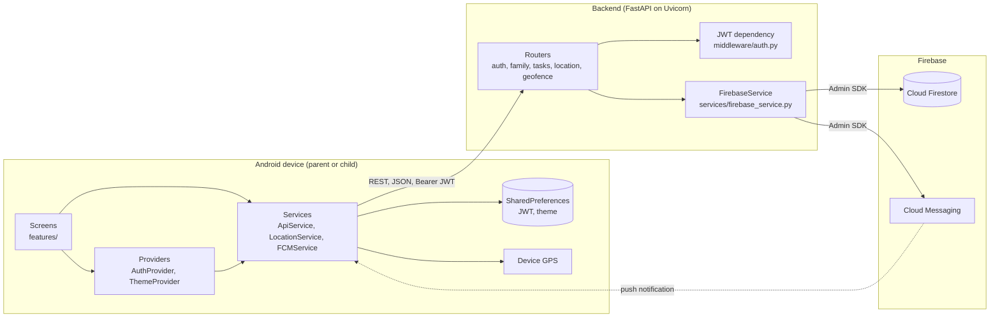
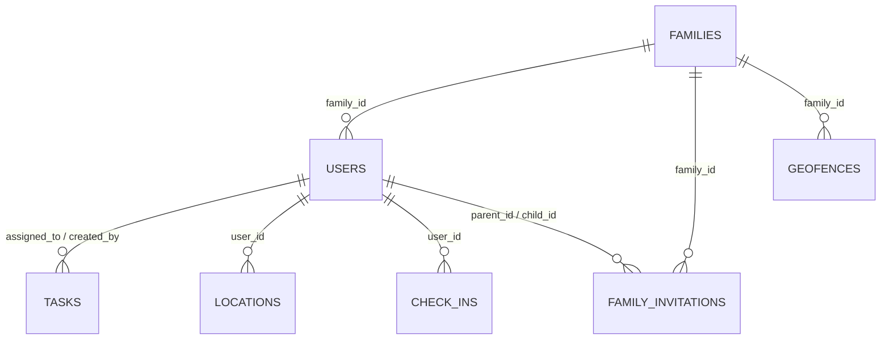

# GuardianLink — Architecture

This document describes how GuardianLink is structured: the components, how they communicate, how data is stored, and how access is controlled. For a general introduction see [PROJECT_OVERVIEW.md](PROJECT_OVERVIEW.md).

---

## 1. System overview

GuardianLink is a three-tier client–server system.



| Tier | Technology | Responsibility |
|---|---|---|
| Client | Flutter / Dart | User interface, local session storage, reading the GPS, calling the API |
| Application server | Python / FastAPI | Authentication, authorisation, business rules, all database access |
| Data and messaging | Firebase Firestore, Firebase Cloud Messaging | Persistent storage and push delivery |

The defining rule of the design is that **the app never accesses Firestore**. All data flows through the backend, which holds the only database credential (a Firebase service-account key).

---

## 2. Mobile app architecture

The app is organised by layer under `core/` and by feature under `features/`.

```
guardianlink_app/lib/
├── main.dart                    App entry, providers, routes, AuthWrapper
├── core/
│   ├── constants/               API base URL and paths, light/dark themes
│   ├── providers/               ThemeProvider
│   ├── services/                ApiService, AuthProvider, LocationService, FCMService
│   └── utils/                   JsonParser (background JSON decoding)
├── models/                      User, Task
└── features/
    ├── auth/screens/            Login, Register
    ├── parent/screens/          Parent home, family management, location, check-ins
    └── child/screens/           Child home, location, invitations, sticker gallery
```

### Layers

| Layer | Contents | Rule |
|---|---|---|
| Presentation | `features/*/screens` | `StatefulWidget` screens. Each screen loads its own data in `initState` and keeps it in local state |
| Application state | `AuthProvider`, `ThemeProvider` | `ChangeNotifier` classes exposed through `provider`. Hold only state that is shared across screens: the signed-in user and the theme |
| Services | `ApiService`, `LocationService`, `FCMService` | All I/O. Screens never call `http` directly |
| Models | `User`, `Task` | Plain Dart classes with `fromJson` / `toJson`. Other responses (children, invitations, locations, geofences, check-ins) are handled as `Map<String, dynamic>` |

### State management

- `provider` is used with a `MultiProvider` at the root of the widget tree ([main.dart:32-36](../guardianlink_app/lib/main.dart#L32-L36)).
- `AuthProvider` is the source of truth for who is signed in. `AuthWrapper` listens to it and chooses the first screen.
- Feature data (task lists, children, locations) is not global. Each screen fetches it from the API and refreshes it with pull-to-refresh or after an action.

### Navigation

- Named routes: `/login`, `/register`, `/parent-home`, `/child-home`.
- `AuthWrapper` is the `home` widget. It shows a spinner while the saved session is checked, then the parent dashboard, the child dashboard, or the login screen.
- Secondary screens are pushed with `MaterialPageRoute` and receive what they need (for example `childId` and `childName`) through their constructors.

### Local storage

Only two values are stored on the device, both in `SharedPreferences`: `auth_token` (the JWT) and `themeMode` (`light`, `dark` or `system`).

---

## 3. Backend architecture

```
backend/app/
├── main.py                      FastAPI app, CORS, router registration, health endpoints
├── config.py                    Settings loaded from .env (cached)
├── middleware/auth.py           Password hashing, JWT create/verify, get_current_user
├── models/                      Pydantic schemas: user, task, location, geofence
├── routers/                     HTTP endpoints: auth, family, tasks, location, geofence
└── services/firebase_service.py All Firestore and FCM operations
```

### Request pipeline

1. Uvicorn receives the request and passes it to FastAPI.
2. The CORS middleware applies the origins from `ALLOWED_ORIGINS`.
3. FastAPI matches a router function and validates the body against its Pydantic model. Invalid input is rejected with HTTP 422 before any code runs.
4. For protected endpoints the `get_current_user` dependency reads the Bearer token, verifies its signature and expiry, and produces `{id, email, role}`.
5. The router function checks the role (and, where relevant, the family relationship), then calls `FirebaseService`.
6. `FirebaseService` reads or writes Firestore, converts timestamps to ISO-8601 strings, and returns plain dictionaries.
7. The router shapes the response, usually through a Pydantic response model.

### Layer responsibilities

| Layer | Responsibility |
|---|---|
| Routers | HTTP concerns, role checks, orchestration of service calls, error-to-status mapping |
| Middleware (`auth.py`) | Cryptography and identity: bcrypt hashing, JWT encode/decode, the `get_current_user` dependency |
| Service (`FirebaseService`) | The only code that knows about Firestore collections and FCM |
| Models | Input validation and response schemas |
| Config | Typed settings, read once and cached with `lru_cache` |

Each router module creates its own `FirebaseService()` instance. The constructor initialises the Firebase Admin app only once per process, so all instances share the same connection.

---

## 4. Data model

Firestore is a document database. The backend uses seven collections. Every document stores its own ID in an `id` field.



| Collection | Fields | Notes |
|---|---|---|
| `users` | `id`, `email`, `password_hash`, `full_name`, `role` (`parent` / `child`), `family_id`, `focus_coins`, `stickers[]`, `fcm_token`, `fcm_token_updated_at`, `created_at`, `updated_at` | One document per account. `family_id` is empty until the user is linked |
| `families` | `id`, `parent_id`, `created_at`, `updated_at` | One per parent. Created on the parent's first invitation. Members are found by querying `users.family_id` |
| `family_invitations` | `id`, `family_id`, `parent_id`, `parent_name`, `parent_email`, `child_id`, `child_email`, `status` (`pending` / `accepted` / `rejected`), `created_at`, `updated_at` | Parent details are copied in so the child's screen needs no extra lookup |
| `tasks` | `id`, `title`, `description`, `priority`, `reward_coins`, `due_date`, `assigned_to`, `created_by`, `status`, `created_at`, `updated_at`, plus `completed_at`, `scheduled_for`, `child_response_at`, `deleted_by`, `deleted_at` when applicable | Deletion is a status change, not a removal |
| `locations` | `id`, `user_id`, `latitude`, `longitude`, `accuracy`, `timestamp` | Append-only. Each update is a new document |
| `check_ins` | `id`, `user_id`, `message`, `latitude`, `longitude`, `timestamp` | Append-only |
| `geofences` | `id`, `family_id`, `name`, `latitude`, `longitude`, `radius` (metres), `created_at` | A circle: centre and radius |

**Indexes.** Two composite indexes are required: `locations (user_id ascending, timestamp descending)` and `check_ins (user_id ascending, timestamp descending)`. Task queries deliberately avoid needing one by filtering in Firestore and sorting in Python.

**Task statuses.** `pending`, `accepted`, `rejected`, `scheduled`, `in_progress`, `completed`, `cancelled`, `deleted`. The transitions the app uses are shown in [WORKFLOWS.md](WORKFLOWS.md#5-task-lifecycle).

---

## 5. Security architecture

### Authentication

- Passwords are hashed with bcrypt (`passlib`) before being stored. The plain password is never saved. Minimum length is 6 characters.
- On register and login the backend issues a JWT signed with HS256 and `SECRET_KEY`. The payload carries `user_id`, `role`, `email` and an expiry (`exp`), 30 minutes by default.
- The app sends the token in the `Authorization: Bearer` header. There is no refresh token; when the token expires the user logs in again.

### Authorisation

Authorisation is enforced in the backend at two levels.

| Level | How | Example |
|---|---|---|
| Role | The router compares `current_user["role"]` | Only a parent may create tasks or send invitations; only a child may complete a task or accept an invitation |
| Relationship | The router loads the child, then the child's family, and requires `family.parent_id` to equal the caller | A parent can read location and check-ins only for children in their own family ([location.py:50-87](../backend/app/routers/location.py#L50-L87)) |

Other ownership rules: an invitation can only be accepted or rejected by the child it was addressed to, and a task can only be deleted by its creator or its assignee.

### Secrets and trust boundary

- The service-account key and `.env` stay on the server and are excluded from version control by [.gitignore](../.gitignore).
- The Admin SDK bypasses Firestore security rules, so the rules protect nothing the app does. Because the app never connects to Firestore directly, the rules can safely deny all client access.
- CORS origins are configurable; this matters only for browser clients, not for the mobile app.
- The development setup uses plain HTTP on the local network. Production needs HTTPS in front of the API.

---

## 6. Communication

| Path | Protocol | Format | Direction |
|---|---|---|---|
| App → Backend | HTTP REST | JSON, snake_case field names, ISO-8601 timestamps | Request / response |
| Backend → Firestore | Firebase Admin SDK (gRPC) | Documents | Request / response |
| Backend → FCM → App | Firebase Admin SDK, then FCM push | Notification title/body plus a string data map | One-way push |

There are no WebSockets or Firestore listeners. The app gets fresh data by requesting it: on screen open, on pull-to-refresh, and after each action.

Error convention: the backend returns `{"detail": "<message>"}` with a 4xx or 5xx status. The app services either throw an exception that the screen shows in a snackbar, or, for list endpoints, log the error and return an empty list.

---

## 7. Key design decisions

| Decision | Reason | Trade-off |
|---|---|---|
| Backend is the only client of Firestore | One place for validation and access rules; no database credentials on the phone | Every operation costs a network round trip through the server; no offline mode |
| Own JWT authentication instead of Firebase Authentication | Full control over roles and token contents with a small amount of code | Password reset, email verification and token refresh must be built separately |
| A single app with role-based dashboards | One codebase and one build for both users | Both roles' screens ship in every install |
| `provider` with screen-local data | Simple and easy to follow for a small app | Data is refetched on each screen rather than cached or shared |
| Geofence status computed on the device | No server work for a simple distance check | The server cannot raise "left the zone" alerts until it evaluates zones itself |
| Soft delete for tasks | Keeps history and lets both sides see what happened | Clients must filter out `deleted` tasks |
| Coins credited immediately on completion | Instant reward for the child, no waiting for the parent | No parent approval step in the active flow |

### Known structural issues

- **Two geofence implementations.** `routers/location.py` (`/api/location/geofence…`, keyed by `family_id`, field `radius`) is the one the app uses. `routers/geofence.py` (`/api/geofence/…`, keyed by `created_by`, field `radius_meters`) is an earlier version that writes to the same collection with a different shape and includes a server-side Haversine check. They should be merged into one.
- **Identity payload is too small.** `get_current_user` returns only `id`, `email` and `role`, while several location endpoints expect `family_id` and `full_name`. This is the cause of the safe-zone and notification failures listed in [PROJECT_OVERVIEW.md](PROJECT_OVERVIEW.md#8-current-state-and-known-gaps).
- **Non-atomic coin updates.** Coins and stickers are updated with read-then-write rather than a Firestore transaction or `Increment`, so concurrent completions could lose an update.

---

## 8. Deployment view

The project currently runs in a development topology.

```
Android phone(s) ──Wi-Fi──► Developer machine: uvicorn app.main:app, port 8000 ──Internet──► Firebase project
```

- The backend is started with `uvicorn app.main:app --reload --host 0.0.0.0 --port 8000`, or with `start_backend.sh`, which runs it in the background and writes `backend/backend.log`.
- The phone and the machine must be on the same network, and `baseUrl` in the app must be the machine's IP address (`10.0.2.2` for the Android emulator).
- For production the backend would move to a hosted server behind HTTPS, `baseUrl` would become a build-time setting, `DEBUG` would be turned off, and the release build would get its own signing key.
