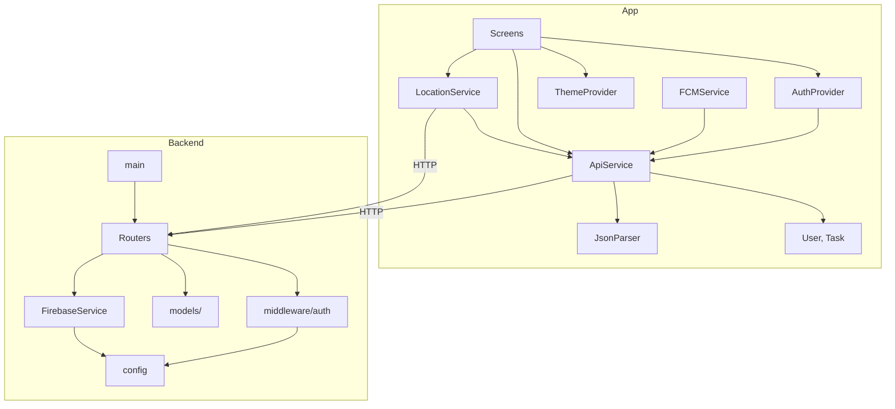

# GuardianLink — Main Modules and How They Work

This document describes each module in the codebase: what it is responsible for, its main classes and functions, and how it connects to the rest of the system. For the overall structure see [ARCHITECTURE.md](ARCHITECTURE.md); for end-to-end flows see [WORKFLOWS.md](WORKFLOWS.md).

- [Part A — Mobile app](#part-a--mobile-app-guardianlink_applib)
- [Part B — Backend](#part-b--backend-backendapp)
- [Part C — Supporting files](#part-c--supporting-files)
- [Module dependency summary](#module-dependency-summary)

---

## Part A — Mobile app (`guardianlink_app/lib/`)

### A1. App entry — [main.dart](../guardianlink_app/lib/main.dart)

| Element | Role |
|---|---|
| `main()` | Initialises Flutter bindings, Firebase and `FCMService`, then runs the app. Firebase errors are caught so the app still starts |
| `MyApp` | Registers `AuthProvider` and `ThemeProvider`, builds `MaterialApp` with light and dark themes and the named routes `/login`, `/register`, `/parent-home`, `/child-home` |
| `AuthWrapper` | The first widget shown. Triggers `checkAuth()` and displays a spinner, the parent dashboard, the child dashboard or the login screen depending on the result |

### A2. Core — constants

| File | Contents |
|---|---|
| [api_constants.dart](../guardianlink_app/lib/core/constants/api_constants.dart) | `baseUrl` of the backend and the paths for auth and tasks. Other paths are written inline in the services |
| [app_theme.dart](../guardianlink_app/lib/core/constants/app_theme.dart) | `AppTheme.lightTheme` and `AppTheme.darkTheme`, both Material 3 with a blue seed colour |

### A3. Core — state providers

**`AuthProvider`** — [auth_provider.dart](../guardianlink_app/lib/core/services/auth_provider.dart)

Holds the signed-in user and the state of the authentication process.

| Member | Purpose |
|---|---|
| `currentUser`, `isAuthenticated` | Who is signed in |
| `isLoading`, `isInitializing`, `error` | Drive the button spinner, the start-up spinner and error messages |
| `register(...)` | Calls the API, stores the returned user |
| `login(...)` | Calls the API, then fetches the full profile with `getCurrentUser()` |
| `logout()` | Clears the token and the user |
| `checkAuth()` | Restores a session at start-up; clears the token if it is no longer valid |
| `updateUser(user)` | Replaces the user after coins or stickers change |

**`ThemeProvider`** — [theme_provider.dart](../guardianlink_app/lib/core/providers/theme_provider.dart)

Holds the `ThemeMode`, loads it from `SharedPreferences` at start-up and saves it on change. `toggleTheme()` switches between light and dark.

### A4. Core — services

**`ApiService`** — [api_service.dart](../guardianlink_app/lib/core/services/api_service.dart)

A singleton that wraps the REST API. It owns the token and builds the `Authorization` header for every request.

| Group | Methods |
|---|---|
| Token | `getToken`, `saveToken`, `clearToken` (memory cache plus `SharedPreferences`) |
| Auth | `register`, `login`, `getCurrentUser` |
| Tasks | `getTasks`, `createTask`, `completeTask`, `rejectTask`, `scheduleTask`, `deleteTask` |
| Family | `sendInvitation`, `getInvitations`, `acceptInvitation`, `rejectInvitation`, `getChildren`, `getFamilyMembers` |
| Location (parent) | `getChildLocation`, `getChildLocationHistory`, `getChildCheckIns` |
| Push | `saveFCMToken` |

Error style: action methods throw an `Exception` carrying the backend's `detail` message; list methods log the error and return an empty list so screens show their empty state.

**`LocationService`** — [location_service.dart](../guardianlink_app/lib/core/services/location_service.dart)

Everything related to position.

| Method | Purpose |
|---|---|
| `requestPermissions()`, `hasPermissions()` | Foreground then background location permission through `permission_handler` |
| `getCurrentLocation()` | One high-accuracy GPS reading through `geolocator` |
| `updateLocation(position)` | `POST /api/location/update` |
| `checkIn(message)` | Reads the position and sends `POST /api/location/check-in`; returns success or failure |
| `getChildLocation(childId)` | `GET /api/location/current/{id}` |
| `getGeofences()`, `createGeofence(...)` | Safe-zone list and creation |
| `getCheckIns(childId, days)` | Check-in history |
| `calculateDistance(...)` | Distance in metres between two coordinates, used for safe-zone status |

It takes the token from `ApiService` and makes its own HTTP calls.

**`FCMService`** — [fcm_service.dart](../guardianlink_app/lib/core/services/fcm_service.dart)

A singleton for push notifications. `initialize()` requests notification permission, obtains the device token, sends it to the backend, and registers listeners for token refresh, foreground messages and notification taps. The message listeners currently log only.

### A5. Core — utilities

**`JsonParser`** — [json_parser.dart](../guardianlink_app/lib/core/utils/json_parser.dart). `parseJson()` decodes a JSON string on a background isolate with `compute`, so large responses do not block the UI thread.

### A6. Models

| Model | Fields | Helpers |
|---|---|---|
| [`User`](../guardianlink_app/lib/models/user_model.dart) | `id`, `email`, `fullName`, `role`, `familyId`, `focusCoins`, `stickers` | `isParent`, `isChild`, `fromJson`, `toJson` |
| [`Task`](../guardianlink_app/lib/models/task_model.dart) | `id`, `title`, `description`, `assignedTo`, `createdBy`, `status`, `priority`, `rewardCoins`, `dueDate`, `createdAt`, `completedAt` | `isCompleted`, `isPending`, `fromJson`, `toJson` |

Both map the API's snake_case JSON to camelCase fields and supply defaults for missing values.

### A7. Feature — authentication (`features/auth/screens/`)

| Screen | What it does |
|---|---|
| [`LoginScreen`](../guardianlink_app/lib/features/auth/screens/login_screen.dart) | Email and password form with validation. Calls `AuthProvider.login()`, navigates by role, and converts errors into readable messages |
| [`RegisterScreen`](../guardianlink_app/lib/features/auth/screens/register_screen.dart) | Name, email, password and a Parent / Child selector. Calls `AuthProvider.register()` and navigates by role |

### A8. Feature — parent (`features/parent/screens/`)

| Screen | What it does | Data it loads |
|---|---|---|
| [`ParentHomeScreen`](../guardianlink_app/lib/features/parent/screens/parent_home_screen.dart) | The Parent Dashboard. Welcome card with the number of linked children; **My Children** list with a **Location** button each; **Check-ins** shortcut; **Create Task** and **Manage Family** buttons; task list with status badges and delete. Also holds the create-task dialog | `getTasks()`, `getChildren()` |
| [`FamilyManagementScreen`](../guardianlink_app/lib/features/parent/screens/family_management_screen.dart) | Invite a child by email; shows pending invitations and linked children | `getChildren()`, `getInvitations()` |
| [`ParentLocationScreen`](../guardianlink_app/lib/features/parent/screens/parent_location_screen.dart) | For one child: last location with coordinates, accuracy and age; safe zones with inside / distance status; the five latest check-ins; dialog to create a safe zone at the child's position | `getChildLocation()`, `getGeofences()`, `getCheckIns()` |
| [`ParentCheckInsScreen`](../guardianlink_app/lib/features/parent/screens/parent_checkins_screen.dart) | Full check-in history for one child with a 24-hour / 7-day / 30-day filter | `getChildCheckIns()` |

### A9. Feature — child (`features/child/screens/`)

| Screen | What it does | Data it loads |
|---|---|---|
| [`ChildHomeScreen`](../guardianlink_app/lib/features/child/screens/child_home_screen.dart) | "My Dashboard". Greeting and Focus Coins balance; shortcuts to **My Location** and **My Stickers**; tasks grouped into active, rejected and completed. Holds the task action dialog (Complete, Later, Reject, Delete) | `getTasks()`, `getCurrentUser()` in parallel |
| [`ChildLocationScreen`](../guardianlink_app/lib/features/child/screens/child_location_screen.dart) | Permission request; current coordinates; **I'm Safe!** check-in button; safe zones with distance. Opening or refreshing it posts the location to the backend | `getCurrentLocation()`, `getGeofences()` |
| [`InvitationsScreen`](../guardianlink_app/lib/features/child/screens/invitations_screen.dart) | Pending family invitations with Accept and Reject | `getInvitations()` |
| [`StickerGalleryScreen`](../guardianlink_app/lib/features/child/screens/sticker_gallery_screen.dart) | Grid of earned stickers with a total count. Reads directly from `AuthProvider`, so it makes no request of its own | — |

---

## Part B — Backend (`backend/app/`)

### B1. Application — [main.py](../backend/app/main.py)

Creates the FastAPI application ("GuardianLink API", version 1.0.0), adds CORS, and mounts the five routers under `/api/auth`, `/api/location`, `/api/tasks`, `/api/family` and `/api/geofence`. Also defines `GET /` and `GET /health`.

### B2. Configuration — [config.py](../backend/app/config.py)

`Settings` is a `pydantic-settings` class that reads `.env`. `secret_key`, `firebase_credentials_path` and `firebase_database_url` have no default, so the server refuses to start without them. `get_settings()` caches the instance.

### B3. Authentication — [middleware/auth.py](../backend/app/middleware/auth.py)

| Function | Purpose |
|---|---|
| `get_password_hash`, `verify_password` | bcrypt hashing and verification |
| `create_access_token(data, expires_delta)` | Signs a JWT with the configured key, algorithm and lifetime |
| `decode_access_token(token)` | Verifies signature and expiry; raises 401 on failure |
| `get_current_user` | FastAPI dependency used by every protected endpoint. Extracts the Bearer token and returns `{id, email, role}` |
| `require_role(role)` | A role-checking dependency factory. Not used; routers check the role inline |

Despite the folder name, this is not an ASGI middleware. It is a set of functions injected with `Depends`.

### B4. Data access — [services/firebase_service.py](../backend/app/services/firebase_service.py)

`FirebaseService` is the only module that touches Firebase. It initialises the Admin SDK from the service-account file on first use and exposes async methods grouped by domain.

| Domain | Methods | Collections |
|---|---|---|
| Users | `create_user`, `get_user_by_email`, `get_user_by_id` | `users` |
| Families | `create_family`, `get_family_by_id`, `add_child_to_family`, `get_family_members`, `get_children_for_parent`, `get_parent_by_family_id` | `families`, `users` |
| Invitations | `create_family_invitation`, `get_pending_invitations`, `get_sent_invitations`, `accept_invitation`, `reject_invitation` | `family_invitations` |
| Tasks | `create_task`, `get_task`, `get_user_tasks`, `get_tasks_by_creator`, `get_family_tasks`, `update_task`, `accept_task`, `reject_task`, `schedule_task`, `complete_task`, `delete_task`, `verify_task` | `tasks` |
| Rewards | `update_user_coins`, `add_user_sticker` | `users` |
| Location | `save_location`, `get_latest_location`, `get_location_history` | `locations` |
| Check-ins | `save_check_in`, `get_check_ins` | `check_ins` |
| Geofences | `create_geofence`, `get_geofence`, `get_family_geofences`, `delete_geofence` | `geofences` |
| Push | `save_fcm_token`, `send_notification` | `users`, FCM |

The helper `serialize_datetime()` converts Firestore timestamps to ISO-8601 strings, including inside nested objects and lists. Business rules for invitations (child must exist, no duplicates, only the addressed child may respond) are enforced here and reported as `ValueError`, which the router turns into HTTP 400.

### B5. Schemas — `models/`

| File | Models |
|---|---|
| [user.py](../backend/app/models/user.py) | `UserRole`, `UserCreate` (password ≥ 6 characters), `UserLogin`, `UserResponse` (includes `focus_coins`, `stickers`), `Token` |
| [task.py](../backend/app/models/task.py) | `TaskStatus`, `TaskPriority`, `TaskCreate` (title 1–200 characters, reward 0–1000), `TaskUpdate`, `TaskResponse`, `TaskCompletionRequest`, `TaskVerificationRequest` |
| [location.py](../backend/app/models/location.py) | `LocationUpdate` (latitude ±90, longitude ±180), `LocationResponse`, `CheckInRequest`, `GeofenceCreate` (radius > 0), `GeofenceResponse` |
| [geofence.py](../backend/app/models/geofence.py) | Schemas for the alternative geofence router |

### B6. Routers — `routers/`

**[auth.py](../backend/app/routers/auth.py) — accounts**

| Endpoint | Logic |
|---|---|
| `POST /register` | Reject duplicate email → hash password → create user → return token and profile |
| `POST /login` | Find by email → verify hash → return token and profile; 401 for any mismatch |
| `GET /me` | Load the full user document for the token's user |
| `POST /fcm-token` | Save the device token on the user |

**[family.py](../backend/app/routers/family.py) — family linking**

Defines its own request and response models (`SendInvitationRequest`, `InvitationResponse`, `FamilyMemberResponse`). Role checks: only parents invite and list children; only children accept and reject. `GET /invitations` returns received invitations for a child and sent invitations for a parent.

**[tasks.py](../backend/app/routers/tasks.py) — tasks and rewards**

| Endpoint | Logic |
|---|---|
| `POST /` | Parent only. Creates a `pending` task |
| `GET /` | Child: assigned tasks. Parent: created tasks. Newest first |
| `PUT /{id}` | Parent only. Partial update |
| `POST /complete` | Child only. Completes the task, adds coins, awards a random sticker, returns the new totals |
| `POST /accept/{id}`, `/reject/{id}`, `/schedule/{id}` | Child only. Status changes |
| `POST /verify` | Parent only. Approval flow; not used by the app |
| `DELETE /{id}` | Creator or assignee only. Soft delete |

**[location.py](../backend/app/routers/location.py) — location, check-ins, safe zones**

| Endpoint | Logic |
|---|---|
| `POST /update` | Stores a location point for the caller |
| `GET /current/{child_id}` | Verifies the caller is the parent of the child's family, returns the latest point |
| `GET /history/{child_id}` | Points from the last `days` |
| `POST /check-in` | Stores the check-in, then looks up the parent and sends an FCM notification |
| `GET /check-ins/{child_id}` | Same parent verification as `/current`, returns the last `days` |
| `POST /geofence`, `GET /geofences`, `DELETE /geofence/{id}` | Safe zones scoped to the family |

**[geofence.py](../backend/app/routers/geofence.py) — alternative geofence API**

An earlier implementation scoped by creator instead of family. Contains `calculate_distance()` (Haversine formula) and `POST /check`, which reports which zones a coordinate falls inside. Not called by the app.

---

## Part C — Supporting files

| File | Purpose |
|---|---|
| [start_backend.sh](../start_backend.sh) | Activates the virtual environment, starts Uvicorn in the background on port 8000, writes `backend/backend.log` and `backend/backend.pid` |
| [stop_backend.sh](../stop_backend.sh) | Stops the Uvicorn process |
| [backend/.env.example](../backend/.env.example) | Template for the backend settings |
| [backend/requirements.txt](../backend/requirements.txt) | Python dependencies (unpinned) |
| [guardianlink_app/pubspec.yaml](../guardianlink_app/pubspec.yaml) | App version, Dart dependencies, launcher-icon configuration |
| [AndroidManifest.xml](../guardianlink_app/android/app/src/main/AndroidManifest.xml) | Declares internet, network-state, fine, coarse and background location permissions. The Google Maps API key entry is present but commented out |
| [android/app/build.gradle.kts](../guardianlink_app/android/app/build.gradle.kts) | Application ID `com.guardianlink.app`, SDK levels, signing |

---

## Module dependency summary

Reading the diagram: screens depend on providers and services; services depend on `ApiService` for the token; on the backend every router depends on the auth dependency, the schemas and `FirebaseService`, and nothing else reaches Firebase.
