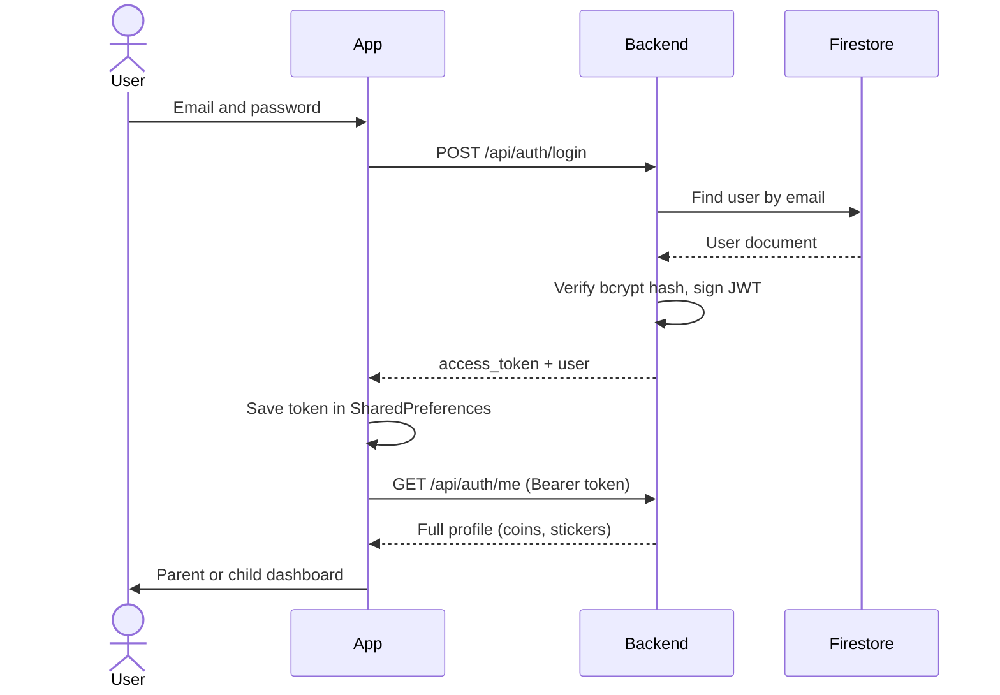
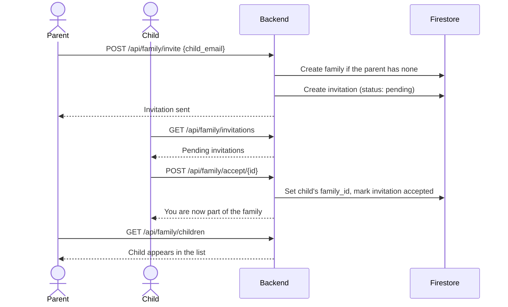
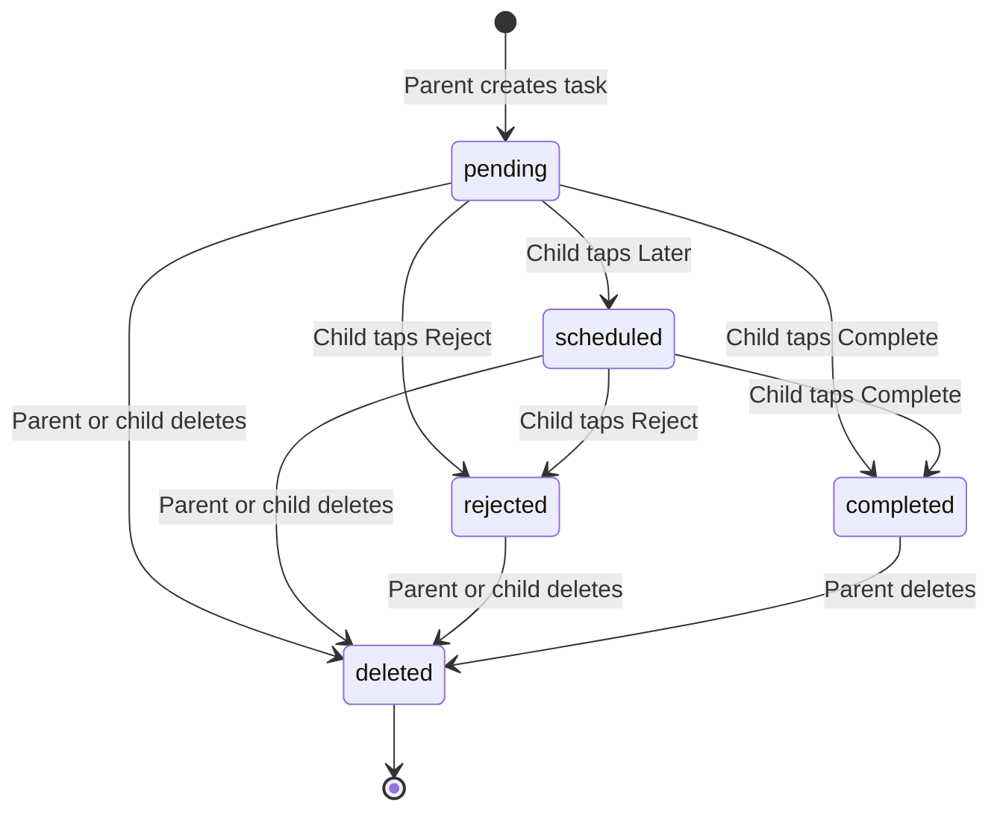
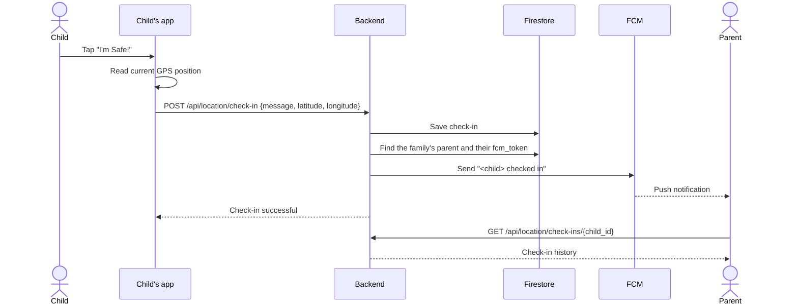

# GuardianLink — Workflows

This document walks through each feature step by step: what the user does, what the app does, what the backend does, and what is stored. For the structure behind these flows see [ARCHITECTURE.md](ARCHITECTURE.md).

Where the code in the repository currently behaves differently from the design, the step is marked **Current behaviour**.

Contents:

1. [App start and session restore](#1-app-start-and-session-restore)
2. [Registration](#2-registration)
3. [Login and logout](#3-login-and-logout)
4. [Linking a child to a family](#4-linking-a-child-to-a-family)
5. [Task lifecycle](#5-task-lifecycle)
6. [Completing a task and earning rewards](#6-completing-a-task-and-earning-rewards)
7. [Location sharing](#7-location-sharing)
8. [Safe zones](#8-safe-zones)
9. [Safety check-in](#9-safety-check-in)
10. [Push-token registration](#10-push-token-registration)
11. [Theme switching](#11-theme-switching)
12. [The complete journey](#12-the-complete-journey)

---

## 1. App start and session restore

**Goal:** open the right screen without asking the user to log in every time.

1. `main()` initialises Flutter, then Firebase and `FCMService`. A failure here is caught and logged, and the app continues ([main.dart:13-25](../guardianlink_app/lib/main.dart#L13-L25)).
2. `MyApp` creates `AuthProvider` and `ThemeProvider`. `ThemeProvider` reads the saved theme.
3. `AuthWrapper` calls `AuthProvider.checkAuth()` and shows a loading spinner.
4. `checkAuth()` reads `auth_token` from `SharedPreferences`.
   - No token: nothing else happens.
   - Token found: the app calls `GET /api/auth/me`. On success the user is stored in `AuthProvider`. On any failure, such as an expired token, the token is deleted.
5. `AuthWrapper` rebuilds:
   - user is a parent → Parent Dashboard
   - user is a child → child's My Dashboard
   - no user → Login screen

---

## 2. Registration

**Actor:** a new parent or child.

1. The user opens **Register** and enters full name, email, password (at least 6 characters) and chooses **Parent** or **Child**.
2. The app sends `POST /api/auth/register` with `email`, `password`, `full_name`, `role`.
3. The backend:
   1. Validates the body (`UserCreate`).
   2. Looks for an existing user with that email and rejects a duplicate.
   3. Hashes the password with bcrypt.
   4. Creates a `users` document with `focus_coins: 0` and no `family_id`.
   5. Issues a JWT and returns it together with the user profile.
4. The app saves the token, stores the user in `AuthProvider`, and navigates to the dashboard for the chosen role.

The user is signed in immediately; there is no email verification step.

---

## 3. Login and logout

1. The user enters email and password on the **Login** screen.
2. The app sends `POST /api/auth/login`.
3. The backend finds the user by email and verifies the password against the stored hash. A wrong email and a wrong password give the same answer: HTTP 401, "Invalid email or password".
4. On success the backend returns a JWT containing `user_id`, `role`, `email` and `family_id`.
5. The app saves the token, then calls `GET /api/auth/me` to load the profile.
6. The app navigates to `/parent-home` or `/child-home`.

**Error handling.** The login screen turns errors into plain messages: invalid credentials, cannot connect to server, or server error.

**Logout.** The user taps the logout icon and confirms. The app deletes the token, clears the user from `AuthProvider`, and returns to the login screen with the navigation history cleared. Nothing is sent to the backend; the token simply expires.

---

## 4. Linking a child to a family

**Precondition:** both the parent and the child have registered.

**Parent side**

1. The parent opens **Manage Family** and enters the child's email.
2. The app sends `POST /api/family/invite`.
3. The backend ([firebase_service.py:320-364](../backend/app/services/firebase_service.py#L320-L364)):
   1. Creates a `families` document for the parent if one does not exist, and sets the parent's `family_id`.
   2. Finds the account with that email and requires its role to be `child`.
   3. Rejects the request if the child is already in this family or already has a pending invitation from it.
   4. Creates a `family_invitations` document with status `pending`.
4. The invitation appears under **Pending Invitations** on the parent's screen.

**Child side**

5. The child taps the mail icon on their dashboard. The app calls `GET /api/family/invitations` and lists pending invitations with the parent's name and email.
6. The child taps **Accept** or **Reject**.
   - **Accept:** the backend checks the invitation is addressed to this child and still pending, sets the child's `family_id` to the family, and marks the invitation `accepted`.
   - **Reject:** the backend marks the invitation `rejected`. The child's account is unchanged.

**Result:** the child is listed under **Linked Children** and **My Children** for the parent, and can now be assigned tasks and located.

The invitation is delivered inside the app only. No email or push notification is sent, so the child has to open the invitations screen to see it.

---

## 5. Task lifecycle

### Creating a task (parent)

1. The parent taps **Create Task** or the **+** button.
2. The dialog asks for a title, a description, the child to assign it to (from the linked children), and a reward from 5 to 50 coins in steps of 5.
3. The app sends `POST /api/tasks/`.
4. The backend checks the caller is a parent, validates the task, and stores it with status `pending`, `created_by` set to the parent and `assigned_to` set to the child.
5. The parent's task list reloads and shows the task with a **Pending** badge.

### Viewing tasks

- Child: `GET /api/tasks/` returns tasks where `assigned_to` is the child. The dashboard groups them into active, **Rejected** and **Completed**.
- Parent: the same endpoint returns tasks where `created_by` is the parent, each with a status badge.
- Both sides hide tasks whose status is `deleted`.

### Child actions

Tapping a task's checkbox opens a dialog with the description, the reward, and four actions:

| Action | Request | Result |
|---|---|---|
| **Complete** | `POST /api/tasks/complete` | Status `completed`; coins and a sticker are awarded (section 6) |
| **Later** | `POST /api/tasks/schedule/{id}` with a time picked for today | Status `scheduled`, `scheduled_for` stored. No reminder is raised at that time |
| **Reject** | `POST /api/tasks/reject/{id}` after confirmation | Status `rejected`. A rejected task can only be deleted |
| **Delete** | `DELETE /api/tasks/{id}` after confirmation | Status `deleted`, with `deleted_by` and `deleted_at` recorded |

### Parent actions

The parent can delete any task they created. The parent sees status changes the next time their list loads or is refreshed.

**Current behaviour.** The snackbars "Parent will be notified" and "Child has been notified" are shown after rejecting and deleting, but no notification is sent. The `accept` and `verify` endpoints exist in the backend and are not used by the app.

---

## 6. Completing a task and earning rewards

1. The child taps **Complete** in the task dialog.
2. The app sends `POST /api/tasks/complete` with the `task_id`.
3. The backend ([tasks.py:108-176](../backend/app/routers/tasks.py#L108-L176)):
   1. Checks the caller is a child and the task exists.
   2. Sets the task's status to `completed` and records `completed_at`.
   3. Adds the task's `reward_coins` to the child's `focus_coins`.
   4. Picks one sticker at random from a pool of ten emoji and appends it to the child's `stickers`. If this step fails the completion still succeeds.
   5. Returns the task with `coins_awarded`, `new_coin_total` and `sticker_awarded`.
4. The app updates the coin counter from `new_coin_total`, shows "Task completed! +N coins" with the sticker earned, then reloads tasks and the profile so `AuthProvider` has the new sticker list.
5. The task moves to the **Completed** group. The sticker is visible under **My Stickers**.

Coins are awarded immediately. There is no parent approval step in this flow.

---

## 7. Location sharing

### Child shares location

1. The child opens **My Location**.
2. If location permission has not been granted, the screen explains why it is needed and offers **Grant Permission**. The app requests foreground location, then background location, and opens system settings if the permission was permanently denied.
3. With permission, the app reads the GPS once at high accuracy and shows latitude, longitude and accuracy.
4. The app sends `POST /api/location/update` with the coordinates, accuracy and timestamp.
5. The backend adds a new document to `locations` for the child.
6. Pull-to-refresh or the refresh icon repeats steps 3–5.

### Parent views location

1. On the Parent Dashboard the parent taps **Location** next to a child.
2. The app calls `GET /api/location/current/{child_id}`.
3. The backend confirms the child exists, belongs to a family, and that the caller is that family's parent. Otherwise it answers 403 or 404.
4. The backend returns the child's newest `locations` document.
5. The screen shows latitude, longitude, accuracy and "Last Updated" as a relative time such as "5m ago". If the child has never shared a location it shows "No location data available".

**Current behaviour.** A location is recorded only when the child opens or refreshes **My Location**. There is no background or periodic tracking, and the location is shown as coordinates, not on a map.

---

## 8. Safe zones

**Design**

1. On a child's location screen the parent taps **Create Safe Zone Here** or **Add**.
2. The parent enters a name (for example "Home") and a radius in metres (default 500). The zone's centre is the child's last known location.
3. The app sends `POST /api/location/geofence` with `name`, `latitude`, `longitude`, `radius`.
4. The backend checks the caller is a parent and stores the zone in `geofences` under the family's ID.
5. Both the parent's and the child's location screens load the family's zones with `GET /api/location/geofences`.
6. For each zone the app calculates the distance between the zone centre and the current position using `Geolocator.distanceBetween`:
   - distance ≤ radius → green tick, "Child is inside" on the parent's screen
   - otherwise → the distance, for example "820m away"

**Current behaviour.** Steps 4 and 5 fail on the server: creating a zone returns HTTP 500 and the list is always empty, so both screens show "No safe zones yet". The cause and the fix are described in [PROJECT_OVERVIEW.md](PROJECT_OVERVIEW.md#8-current-state-and-known-gaps), items 1–3. The distance calculation and the screens are complete and will work once the server returns zones.

Zone status is evaluated only when a screen is opened or refreshed. No alert is raised when a child enters or leaves a zone.

---

## 9. Safety check-in

**Design**

1. On **My Location** the child taps **I'm Safe!**.
2. The app reads the current position and sends `POST /api/location/check-in` with the message "I'm safe!" and the coordinates.
3. The backend stores a `check_ins` document.
4. The backend looks up the parent of the child's family. If the parent has a saved `fcm_token`, it sends a push notification titled "<child name> checked in" with the message as the body and the child ID, coordinates and check-in ID as data.
5. The child sees "Check-in successful! Parent notified." and the time of the last check-in.
6. The parent reads check-ins in two places:
   - the child's location screen shows the five most recent
   - **Check-ins** on the dashboard shows the full list with time and coordinates, filterable to the last 24 hours, 7 days or 30 days. With more than one child, the parent first chooses which child.

**Current behaviour.** Steps 1–3, 5 and 6 work. Step 4 does not send anything: the backend cannot see the child's `family_id` in the request context, and the parent's device token is not being stored (section 10). Details are in [PROJECT_OVERVIEW.md](PROJECT_OVERVIEW.md#8-current-state-and-known-gaps), items 2, 4 and 5.

---

## 10. Push-token registration

**Design**

1. At start-up `FCMService.initialize()` asks for notification permission and gets the device's FCM token.
2. The app sends the token to `POST /api/auth/fcm-token`.
3. The backend saves it as `fcm_token` on the user's document.
4. If Firebase rotates the token, the `onTokenRefresh` listener sends the new one.
5. Incoming messages are handled by two listeners: `onMessage` while the app is open and `onMessageOpenedApp` when the user taps a notification.

**Current behaviour.** The token is not stored, for three reasons: Firebase does not initialise on Android because the `google-services` Gradle plugin is not applied; the token is sent at start-up, before there is a logged-in user; and the app sends it in the JSON body while the endpoint reads a query parameter. The two message listeners only log what they receive.

---

## 11. Theme switching

1. The user taps the sun / moon icon in the dashboard's app bar.
2. `ThemeProvider.toggleTheme()` switches between light and dark and notifies the app.
3. `MaterialApp` rebuilds with the other theme.
4. The choice is saved under `themeMode` in `SharedPreferences` and restored at the next launch. Until the user chooses, the app follows the system setting.

---

## 12. The complete journey

A typical first use, from two phones:

| Step | Parent | Child |
|---|---|---|
| 1 | Registers as **Parent** | Registers as **Child** |
| 2 | Opens **Manage Family**, invites the child's email | |
| 3 | | Opens the mail icon, accepts the invitation |
| 4 | Sees the child under **My Children** | |
| 5 | | Opens **My Location** (shares location), taps **I'm Safe!** |
| 6 | Taps **Location** on the child to see the last position and recent check-ins | |
| 7 | Creates a task with a coin reward | |
| 8 | | Sees the task, taps **Complete**, earns coins and a sticker |
| 9 | Refreshes and sees the task as **Completed** | Views the sticker under **My Stickers** |
